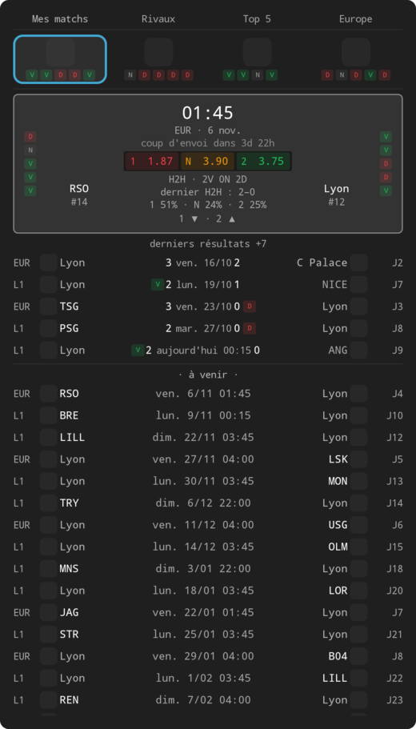
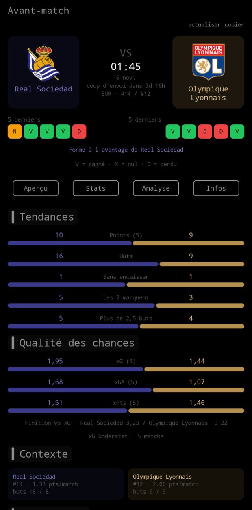
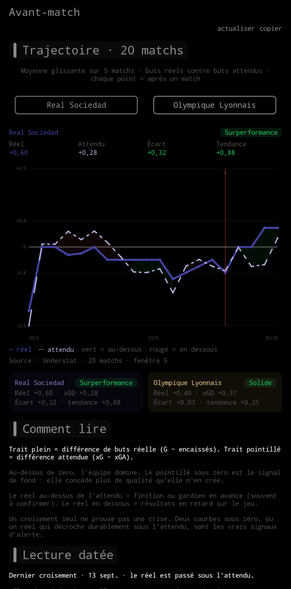
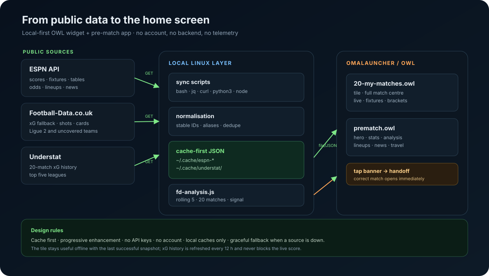
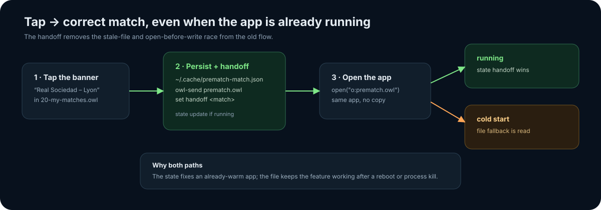
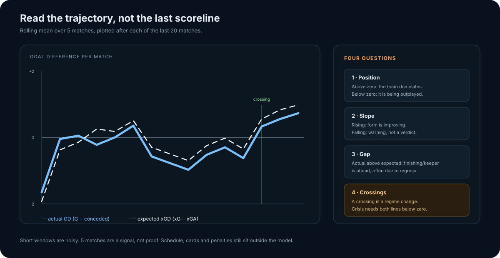

<div align="center">

# My Matches

**Le centre de match qui vit sur votre écran d'accueil.**

Un widget OWL et une app avant-match pour [Omalauncher](https://github.com/SimonSchubert/omalauncher).
Scores live, calendrier, classements, coupes, cotes, xG et une trajectoire de
performance sur 20 matchs — sans compte, sans backend, sans publicité.

[](https://github.com/SimonSchubert/omalauncher)
[](https://github.com/Tasour/omalauncher-my-match)
[](https://github.com/Tasour/omalauncher-my-match)
[](LICENSE)
[](CONTRIBUTING.md#before-opening-a-pull-request)

[Captures](#captures) · [Fonctionnalités](#ce-que-vous-obtenez) ·
[Architecture](#comment-ça-marche) · [Installation](#installation) ·
[Données](#données-vie-privée-et-limites)

</div>

---

## Le problème

Un widget de scores répond à une seule question : **« quel est le score ? »**.

Avant un match, il faut répondre à beaucoup d'autres : quelle est la forme des
deux équipes, qui domine les occasions, le classement est-il trompeur, les
compositions sont-elles sorties, le match est-il piégeux, et surtout — **est-ce
que la dynamique de l'équipe s'améliore ou se casse ?**

La réponse classique est d'ouvrir trois applications, six onglets et une
dizaine de publicités. Sur un launcher, c'est un contresens : l'écran d'accueil
devrait montrer l'essentiel **avant** qu'on le demande.

## La réponse

**My Matches** transforme Omalauncher en cockpit de match :

- une tuile compacte pour la journée, les résultats et les échéances ;
- un centre de match pour les compétitions, les tableaux et les rappels ;
- une app avant-match dédiée au match affiché, ouverte d'un tap ;
- une analyse xG qui raconte la tendance sur **20 matchs**, pas seulement le
  dernier score.

Tout reste dans Omalauncher. Pas d'APK, pas de compte, pas de synchronisation
cloud : des fichiers OWL lisibles, des scripts locaux et des caches JSON.

## Captures

<p align="center">
  
  
  
</p>
<p align="center">
  <sub>Accueil · Avant-match · Analyse xG — données réelles, rendu réel.</sub>
</p>

## Ce que vous obtenez

| Surface | Contenu |
|---|---|
| **Accueil** | Prochain match, live, forme des deux équipes, cotes, compte à rebours et derniers résultats |
| **Centre de match** | Mes matchs, rivaux, Top 5, Europe, classements, calendrier 10 jours, arbres de coupe et réglages |
| **Avant-match** | Hero VS, tendances, classement complet, H2H, cotes, compositions, actus, voyage, radar et carte attaque/défense |
| **Analyse xG** | Trajectoire réelle vs attendue, rolling 5 sur 20 matchs, croisements, tendance, écart et lecture guidée |
| **Jour de match** | Rappels, Goal Flash, anti-spoiler, mode matchday, filtre du jour et copie/partage |
| **Fiabilité** | Cache-first, sources gated, backoff réseau, mode hors ligne et journal de santé |

L'app avant-match est ouverte depuis le bandeau du match. Le bon match est
transmis par un état `handoff`, avec un fichier JSON comme filet de sécurité
pour un démarrage à froid.

## Comment ça marche



Trois couches, volontairement simples :

1. **Sources publiques** — ESPN pour le live, les fixtures, les classements, les
   cotes, les compos et les actus ; Football-Data.co.uk pour les xG de secours ;
   Understat pour l'historique xG des cinq grands championnats.
2. **Moteur local** — scripts `bash`/`jq`/`perl`, synchronisation Python et
   analyse Node. Les données sont normalisées, dédupliquées et écrites dans
   `~/.cache/` ; une source lente ne bloque jamais l'écran.
3. **OWL / Omalauncher** — la tuile et l'app lisent ces caches avec les sources
   `file(...)` et `cmd(...)`. Canvas dessine les graphiques sans animation
   continue, pour rester lisible et économe.

Le détail des cadences, des modes de panne et des caches est dans
[`docs/architecture.md`](docs/architecture.md).

### Le handoff avant-match



Le bandeau fait deux choses au même moment : il écrit le match dans
`~/.cache/prematch-match.json` et pousse l'état `handoff` dans l'app déjà
ouverte. L'app préfère l'état pour un process chaud, et retombe sur le fichier
après un redémarrage. C'est ce qui évite d'afficher le match précédent.

### Lire la trajectoire xG



- **Trait plein** : différence de buts réelle, `G − encaissés`.
- **Trait pointillé** : différence attendue, `xG − xGA`.
- **Zone verte / rouge** : le réel est au-dessus / en dessous de l'attendu.
- **Marqueur** : dernier croisement des deux courbes.
- **Badge** : synthèse courte de la position, de l'écart et de la tendance.

Un croisement **n'est pas une crise à lui seul**. Le signal fort est un xGD
durablement sous zéro avec un réel qui décroche sous l'attendu. Les sources,
la méthode et les limites sont détaillées dans
[`docs/design/trajectory-xg-2026-11-01.md`](docs/design/trajectory-xg-2026-11-01.md).

## Installation

### Prérequis

- Omalauncher avec OWL 16 ;
- Linux invité actif, avec `curl`, `jq`, `perl` et `python3` ;
- Node.js 20+ pour l'analyse xG (le wrapper cherche aussi le Node de mise) ;
- facultatif : `owl-check` pour valider le rendu et les sources.

```sh
git clone https://github.com/Tasour/omalauncher-my-match \
  ~/.config/omalauncher/widgets/omalauncher-my-match
cd ~/.config/omalauncher/widgets/omalauncher-my-match

cp widget/my-match.optimized.owl ~/.config/omalauncher/widgets/20-my-matches.owl
cp widget/prematch.owl          ~/.config/omalauncher/widgets/prematch.owl
cp scripts/fd-sync.py scripts/fd-analysis.js scripts/fd-analysis.sh \
  ~/.config/omalauncher/widgets/
```

Puis :

```sh
owl-check 20-my-matches.owl
owl-check prematch.owl
```

Ajoutez la tuile 6×4 à l'accueil, choisissez vos équipes, et laissez les
premiers caches se remplir. L'analyse xG apparaît après la première
synchronisation Understat/Football-Data.

## Utilisation

- **Accueil** : la tuile montre le prochain match et les résultats. Le bandeau
  ouvre directement le bon avant-match.
- **Centre de match** : onglets Mes matchs / Rivaux / Top 5 / Europe,
  classements repliés, calendrier et arbres de coupe.
- **Avant-match** : Aperçu, Stats, Analyse, Infos. Les compositions apparaissent
  seulement quand elles sont publiées.
- **Jour de match** : activez les rappels, Goal Flash et l'anti-spoiler depuis
  les réglages de la tuile.

## Données, vie privée et limites

| Source | Usage |
|---|---|
| ESPN | Live, fixtures, classements, cotes, compositions, actus, écussons |
| Football-Data.co.uk | xG de secours, tirs et cartons |
| Understat | Historique xG des cinq grands championnats |

Aucun compte, aucune télémétrie, aucune donnée personnelle envoyée. Tout ce qui
est conservé reste sur l'appareil :

- `~/.cache/espn-*` : données ESPN et caches xG Football-Data ;
- `~/.cache/understat/` : historiques xG ;
- `~/.cache/prematch-match.json` : dernier match choisi.

Suppression : `rm -rf ~/.cache/espn-* ~/.cache/understat`. Voir la
[notice de données](docs/data-notice.md) pour l'attribution et les précautions.

**Limites assumées** : Ligue 2 n'a pas d'historique Understat ; le graphe
retombe sur les matchs xG disponibles. Les fenêtres glissantes se chevauchent,
le xG est un modèle, et le calendrier, les cartons et les pénos ne sont pas
neutralisés. Le test de décharge appareil reste une validation manuelle.

## Performance et fiabilité

- live : 1 min uniquement quand un match est en direct, sinon source gated ;
- scoreboards : 15 min ; classements : 6 h ; cotes : 1 h ; xG : 12 h ;
- cache-first : un échec réseau conserve la dernière capture valide ;
- écritures de caches atomiques, backoff, `Retry-After` et jitter ;
- pas d'animation permanente dans les graphiques ; images plafonnées.

Le widget principal et l'app restent compacts : le premier tient en 6×4, l'app
est pensée pour un écran de téléphone, pas pour un dashboard de bureau.

## Tests

```sh
make test       # suite rapide hors ligne : extraction, bash -n, fixtures, garde-fous
make test-all   # sources secondaires, pannes réseau, concurrence de caches
```

`owl-check` reste la validation de rendu sur l'appareil. La CI portable est
décrite dans `scripts/ci.sh` ; un modèle GitHub Actions est fourni dans
[`docs/ci-workflow.yml`](docs/ci-workflow.yml).

## Structure

```text
widget/                production OWL files
  my-match.optimized.owl
  prematch.owl
scripts/               data sync, xG analysis, CI, widget extraction
tests/                 offline fixtures and regression checks
docs/
  architecture.md      data flow, handoff, caches
  assets/              screenshots and diagrams
  audits/              focused audits
  design/              xG reflection, feature proposals, research
  measurements/        device measurement protocols
  reports/             archived HTML reports
archive/               v5.7 baseline and one-off experiments
measurements/          raw measurement guide
```

The full documentation index is [`docs/README.md`](docs/README.md).

## Contribuer

Les changements doivent préserver trois choses : le fonctionnement hors ligne,
la lisibilité sur téléphone et l'absence de secret dans le dépôt.

```sh
make test-all
owl-check widget/my-match.optimized.owl
owl-check widget/prematch.owl
```

Pour une nouvelle source ou un nouveau graphique, documentez la provenance, le
cache et le comportement en cas d'échec. Les données Understat/Football-Data et
les marques ESPN ne sont pas couvertes par la licence MIT du code.

## Licence et crédits

Le code des widgets et des scripts est sous licence **MIT** — voir
[`LICENSE`](LICENSE), copyright © 2026 Tasour.

Les données, écussons, noms et marques restent la propriété de leurs ayants
droit, notamment **ESPN**, **Understat**, **Football-Data.co.uk**, les ligues et
les clubs. Le projet n'est ni affilié, ni sponsorisé, ni approuvé par ces
sources. Les cotes affichées sont informatives et ne constituent pas un conseil
de pari.

Merci à [Omalauncher](https://github.com/SimonSchubert/omalauncher) pour le
runtime OWL, et aux mainteneurs des données publiques qui rendent ce widget
possible.
