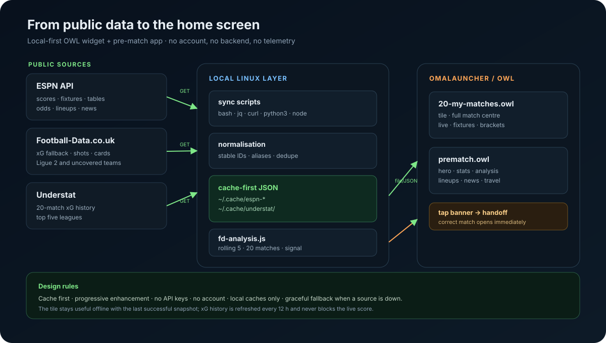
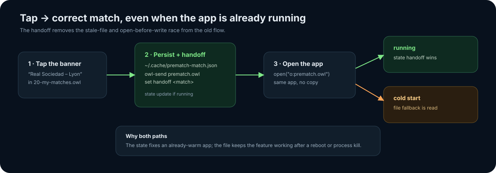
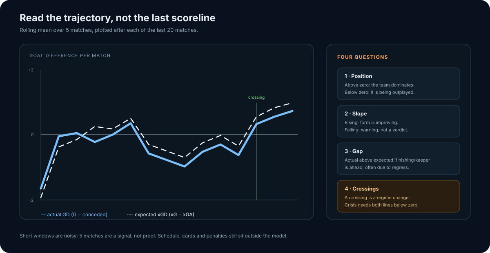

# Architecture

My Matches is intentionally small: two OWL files, a handful of local scripts,
and JSON caches. There is no server, account, database or API key.

## The two surfaces

| Surface | File | Role |
|---|---|---|
| Home tile + match centre | `widget/my-match.optimized.owl` | Live scores, fixtures, tables, cup brackets, reminders, sharing and the banner that opens the pre-match app |
| Pre-match app | `widget/prematch.owl` | Hero, form, standings, H2H, odds, lineups, news, travel and the xG analysis |

Both are OWL 16 files. They run inside Omalauncher and use the launcher's Linux
guest for shell, Python and Node work.

## Data flow

1. **Collect.** The main widget runs ESPN requests through `curl`, normalises
   them with `jq`/`perl`, and writes JSON caches under `~/.cache/espn-*`.
2. **Cache.** A source never blocks the screen on a slow request. The last
   successful snapshot is rendered first; a failed refresh keeps it.
3. **Enrich.** `scripts/fd-sync.py` reads Football-Data.co.uk, maps club names
   with explicit aliases, and writes `~/.cache/espn-fd.json`. It is the fallback
   for Ligue 2 and teams not covered by Understat.
4. **Analyse.** `scripts/fd-analysis.js` combines Understat's 20-match history
   for the top five leagues with the Football-Data fallback, computes rolling
   5-match series, percentiles and signals, and writes
   `~/.cache/espn-fd-analysis.json`.
5. **Render.** OWL `file(...)` and `cmd(...)` sources read those caches. Canvas
   draws the trajectory, radar and scatter without animation or layout churn.

### Refresh budget

| Data | Cadence | Notes |
|---|---|---|
| Live match state | 1 min | Only while a match is live; otherwise gated |
| Scoreboards / fixtures | 15 min | Cache-first, stale-safe |
| Standings | 6 h | Complete table available on demand |
| Odds / lineups / news | 1 h | Match-scoped caches |
| xG history | 12 h | Understat + Football-Data |
| Crests | 1 h | Atomic writes and locks |

## The pre-match handoff

The old flow wrote a JSON file and opened the app immediately. On a warm app,
the file source could still hold the previous match, so the banner could open
the wrong fixture.

The fix has two paths:

- **Warm app:** the banner runs `owl-send prematch.owl set handoff <match>`.
  The running app updates its `handoff` state immediately.
- **Cold start:** the same match is written to
  `~/.cache/prematch-match.json`; the app falls back to that file if no handoff
  state exists.

The app therefore always has a deterministic source of truth, independent of
the open/write race.

## The xG trajectory

The analysis tab shows what results hide: the direction of travel over 20
matches, with two 5-match rolling means.

- **Solid line** — `G − conceded` (actual goal difference).
- **Dashed line** — `xG − xGA` (expected goal difference).
- **Green / red bands** — actual above / below expected; no band is drawn
  across a crossing, so the chart never creates misleading triangles.
- **Last crossing marker** — the most recent regime change, not a crisis verdict.
- **Signal badge** — a short reading of the current position, gap and trend.

A crossing alone is not a crisis. The app raises the strongest warning when the
expected line is durably below zero **and** the actual line drops below it.
The full reading guide and sources are in
[`design/trajectory-xg-2026-11-01.md`](design/trajectory-xg-2026-11-01.md).

## Failure modes

| Failure | Behaviour |
|---|---|
| ESPN down or rate-limited | Last cache stays visible; backoff, `Retry-After`, jitter |
| Understat unavailable | Football-Data series or existing cache; no empty chart |
| Node missing | The analysis file stays readable; the shell wrapper looks for mise's Node |
| No live match | Live source is gated off; no polling every minute |
| No network at all | All cached screens remain usable |

## Scope and limits

- Ligue 2 has no Understat history; it falls back to the matches with xG in
  Football-Data's current season.
- xG is a model, not a truth. Short windows are noisy and overlapping.
- Schedule strength, cards, penalties and game state are not neutralised.
- Device battery measurements are documented but the final unplugged drain
  test is still a manual device gate.
